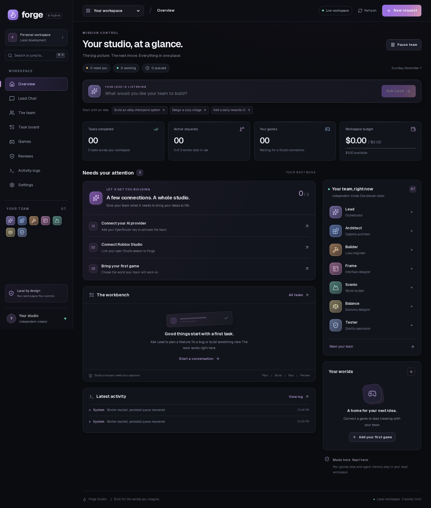

# Forge Studio

A local-first Roblox AI development studio built with Next.js, TypeScript, Tailwind CSS, shadcn/ui-compatible Radix button components, SQLite, LangGraph.js, and the official MCP TypeScript SDK. Compact dark workspace with a project toolbar, agent navigation, grouped reviews, and responsive layouts based on the supplied design reference. See [design decisions](docs/DESIGN.md).



## Start here

Requires Node.js 22+, npm, an OpenRouter API key with credit, and current Roblox Studio **on the same Windows/macOS machine as the worker**. Roblox Studio is not available natively on this Linux build machine.

```bash
cd /root/forge-studio
npm ci
cp .env.example .env
# Edit .env: add OPENROUTER_API_KEY and Studio's official MCP command.
npm run worker
```

In another terminal:

```bash
npm run dev
```

Open **http://127.0.0.1:3000**. For a convenient combined development launcher use `npm run local`. For production use `npm run build`, then `npm run start` alongside `npm run worker`. The worker is independent of the dashboard and browser: closing either does not stop agents. Keep the worker terminal open, or run it under your OS service manager (systemd, launchd, or a Windows service).

To copy this project to a Studio computer, copy the directory excluding `node_modules`, `.next`, `.data`, and `.env`, then run `npm ci` and configure a new `.env`. Never copy a Linux `node_modules` folder to Windows/macOS: SQLite uses native binaries.

## Connect real Roblox Studio

1. Open a place in Roblox Studio. Assistant → **… → Manage MCP Servers** → **Enable Studio as MCP server**.
2. Copy the official command and arguments into Settings, save, then click **Connect / reconnect**. The worker dynamically discovers actual tool schemas; no third-party Roblox plugin is required.
3. On macOS the official executable is `/Applications/RobloxStudio.app/Contents/MacOS/StudioMCP` with arguments `[]`.
4. On Windows use executable `cmd.exe` and arguments `["/c","C:\\Users\\YOU\\AppData\\Local\\Roblox\\mcp.bat"]`. Use an absolute path with your actual username (environment variables inside JSON arguments are not automatically expanded by this app).
5. Games → **Discover Studios**. Copy the returned `studio_id`, enter a game name and that ID, then add the game. Each request pins its target Studio ID; changing the selected game cannot redirect an existing run.
6. Set `OPENROUTER_API_KEY` in `.env` and restart the worker. Default verified catalog model ID: `deepseek/deepseek-v4.1-flash`. Every agent has an independently configurable model, prompt, temperature, token limit and enabled state under Team.
7. Send a request in Lead Chat. Lead makes a dependency graph; specialists inspect and implement through real MCP calls. Go to Reviews to inspect and approve the exact arguments of every mutation, including Luau execution and play controls. The task resumes on approval.
8. Tester independently reads the implementation, starts a playtest, collects console evidence, stops playtesting and records a verdict. Passing work enters user review; accept it or request changes. New implementation handoffs and revisions require new verification.

Suggested first request: “Add a server-side checkpoint system to my obby. Preserve the existing map. Use numbered checkpoint parts, validate touches server-side, and verify respawn behavior in a playtest.” Save a place version before starting a significant change.

## Runtime architecture

- **Next.js** serves eleven responsive dashboard pages and a same-origin API proxy. All privileged operations go through the local worker. No browser-bundled API keys.
- **Worker** (`worker/index.ts`) binds to `127.0.0.1:4318`. Authenticated HTTP uses a random 0600 local token, and WebSocket broadcasts only refresh notifications. The UI fetches protected snapshots through Next. HTTP polling is the fallback. `WORKER_PORT` is configurable; restart both processes when changing it.
- **Seven independent agents** each have isolated prompts, persistent memory, conversation/tool context, role-based tools, task histories and execution cycles. Lead delegates; Architect designs; Builder codes Luau; Frame builds UI; Scenic builds worlds; Balance tunes economies; Tester checks behavior. Every model turn is a genuine separate OpenRouter request; there is no production simulator or seeded activity.
- **LangGraph** runs reason/tool phases with persistent SQLite checkpoints per task thread. Task messages and tool outcomes are separately persisted to support partial tool batches and restart recovery. The SQLite dependency scheduler runs at most three workers concurrently and one task per agent. Dependencies, retries with backoff, handoffs, blocked-task recovery, step limits and user review are durable.
- **Studio access** uses SDK stdio transport and discovered official tool schemas. Tool lists are intersected with role allowlists. A per-Studio database lock serializes all place operations, including reads, so agents never inspect a partially applied concurrent operation. Approval decisions bind to persisted tool call IDs and exact payloads. Unknown tools are denied; arbitrary Luau is always considered a mutation.
- **Recovery** uses a tool-call ledger to prevent reapplying finished operations. If a write was interrupted or returned an ambiguous transport error, the task fails rather than replaying the call. Reviews shows uncertain operations: inspect Studio, record whether the call took effect, then retry the task in Tasks. Reservations for ambiguous provider calls remain counted against the cap.
- **SQLite** uses WAL and transactions for tasks, agents, private memories, chat, games, runs, approvals, events, usage, locks and tool calls. Runtime data is in `.data/forge.sqlite` and `.data/checkpoints.sqlite`. Back up `.data` with processes stopped; do not commit it.

### Spending behavior

The cap defaults to **$9** for the lifetime of this local database, across all agents and games. The worker retrieves the OpenRouter catalog and pricing. Before each call it transactionally reserves a conservative upper bound using the model’s entire context window at the higher token price, with an additional margin. These reservations count against the cap during parallel requests. This deliberately may prevent a request well before the remaining budget is exhausted. Settings shows actual spending and reservations separately.

Successful calls record prompt/completion tokens and provider-reported `usage.cost`; if the provider omits cost, the ledger explicitly labels the catalog calculation as estimated. Unknown network outcomes retain reservations; definitive rejected requests release them. No local application can enforce a provider account’s billing policy or future price changes: also set an OpenRouter key credit limit for an account-level ceiling. There is no UI to silently discard an uncertain charge.

### Approval and rollback boundaries

Approvals default on and can be explicitly disabled in Settings after pausing active work. Tester’s Luau is also gated because a “read-only” script can mutate state. This is a personal, trusted-machine application, not an internet-facing multi-user service. Settings can launch the configured MCP executable; do not expose the dashboard or worker to untrusted users.

The current official MCP tool catalog does **not** promise a universal undo/rollback primitive. Forge never fabricates rollback success. Use Studio Undo when applicable or restore a saved place version, verify the resulting state, and then reconcile uncertain calls. The complete approved arguments and call results remain in the SQLite ledger. MCP image responses are stored as evidence; text-only model configurations should rely on structural and console tools rather than visual-only inspection.

## Verification

```bash
npm run typecheck
npm test
npm run build
# With worker + dashboard running:
npx playwright install chromium
node scripts/smoke.mjs
node scripts/ui-smoke.mjs
node scripts/desktop-smoke.mjs
node scripts/library-smoke.mjs
node scripts/redesign-smoke.mjs
```

The integration test replaces **only model responses** with deterministic test responses and launches a **test-only MCP stdio server** through the actual SDK. It verifies Lead delegation → queued Builder → approval before file modification → independent Tester read/play/console evidence → user review, plus budget reservations, unauthorized-tool rejection and restart recovery. The test does not spend OpenRouter credit and is not a real Roblox playtest.

Browser smoke checks visit all nine pages, check console errors and mobile overflow, and write desktop/mobile screenshots to `artifacts/`. The extended UI check covers 1440px, 768px and 390px layouts, quick prompts, Ctrl/Cmd+K navigation, Escape handling, and agent selection during live refreshes. Approval-state fixtures stay in browser request interception and never enter the application database. The redesign check additionally covers populated reviews from 320px to 1540px, partial batch failures, rejection cancellation, media inspection, revision feedback, acceptance, uncertain-operation recovery, and mobile navigation.

The dashboard includes a compact Lead request bar, actionable setup and approval cards, live agent rows, game progress and budget tracking. Search pages, agents and tasks with **Ctrl/Cmd+K**. The selected game persists across pages and reloads. Geist is served locally under its included SIL Open Font License (`public/fonts/OFL.txt`).

**Verified here:** dependency installation; production build; TypeScript; SDK protocol integration workflow; budget, permissions and recovery tests; local UI/browser checks (see delivery report for results).

**Requires your environment:** an actual paid OpenRouter completion and a live Roblox Studio modification/playtest. No API credential or running Studio instance was supplied, so neither can honestly be reported as live-verified. Configure both and follow the eight steps above to perform that final integration check.

## Official references

- Roblox Studio MCP setup and current tool catalog: https://create.roblox.com/docs/studio/mcp
- MCP TypeScript SDK: https://github.com/modelcontextprotocol/typescript-sdk
- LangGraph persistence: https://docs.langchain.com/oss/javascript/langgraph/persistence
- OpenRouter model catalog: https://openrouter.ai/api/v1/models
- OpenRouter usage accounting: https://openrouter.ai/docs/use-cases/usage-accounting

## Library

Open **Library** in the sidebar to browse 31 attributed official Roblox guides covering security, data, Luau, networking, performance, UI, world building, design, economy and release workflows. Search article text and code, bookmark references, or open a guide to read its practical do/don’t notes and offline source text. Add your own guides, source links, Markdown files and images with **Add reference**. All seven agents can consult this library while working. Personal references stay in `.data/forge.sqlite`.

For source attribution, licensing and optional Python refresh instructions, see [library/README.md](library/README.md). The bundled pack works on Windows without installing Python; Python is needed only to scrape a newer source pack.

## Desktop workspace

Forge uses a near-black canvas, a persistent project toolbar, and a compact sidebar with real agent, task, review, and budget information. On phones, navigation opens in a keyboard-accessible drawer. Reviews group proposed changes and media deliverables, with detailed inspection, batch approvals, rejection confirmation, and revision feedback. In **Settings → Workspace appearance**, choose **Nord**, **Graphite** or **Evergreen**, select compact/comfortable density, and toggle focus mode. These preferences are saved on the current browser.

**Alt+1…9** switches pages, **Alt+F** toggles navigation, **Ctrl/Cmd+K** opens the launcher, and **?** shows shortcuts. Workspace shortcuts do not run while editing text. Launcher task results open the matching task inspector. Failed and blocked tasks also appear in the workspace recovery pane.

Use **Download diagnostics** in the sidebar or Settings to save connection status, model configuration flags, task counts and spending totals for troubleshooting. The export excludes credentials, prompts and messages. See [docs/DESIGN.md](docs/DESIGN.md) for the design system, review behavior, and verification details.

## V2 features

The existing Forge design is retained. New workspaces add project-scoped streamed Lead responses, explicit execution-plan approval, agent work panels and follow-ups, structured tasks with priority/dependencies, safe pause/cancel controls, tracked human questions, persistent review notes/history, and reusable assets/systems. See [the feature audit and integration guide](docs/FEATURE_AUDIT_V2.md).

Games includes lifecycle metadata and LiveOps views. Market and LiveOps accept validated JSON exports with a source URL, ISO 8601 observation time, and quality (`exported`, `sampled`, or `estimated`). Their Import dialogs document the JSON format. No live telemetry or market feed is connected by default. Pitches retain versions and market evidence; an accepted pitch can become a planning project and an approval-gated Lead task.

Library defaults to the existing References section, with Assets and Systems tabs alongside it. Local media uploads are limited to 2 MB and validated against their declared type. Larger media can be referenced by URL. Script/module content is stored as text; importing or approving an artifact never executes, installs, uploads, or publishes it. Task and run stops take effect at execution boundaries; an already-sent Studio operation may finish.

Quick verification is `npm test` plus `npm run build`. For browser integration, start the worker and web app with the same explicitly isolated `/tmp/forge-v2-*` `FORGE_DATA_DIR`, then run `FORGE_DATA_DIR=/tmp/forge-v2-check node scripts/features-v2-smoke.mjs`. It tests the changed workflows and focused mobile layouts. Add `--full` for the longer all-route, three-width matrix. The script refuses a production data directory. All captured V2 examples use that isolated database.
